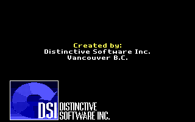
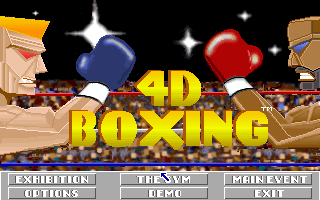
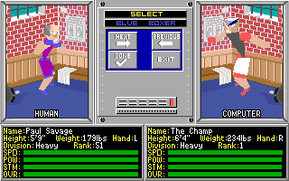
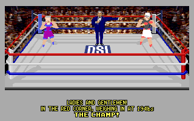
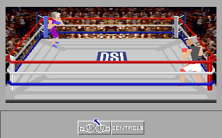

<p align="center">
	<a href="https://github.com/ToolAssisted-run/Open4DBoxing/actions/workflows/ci.yml"></a>
	<a href="https://github.com/ToolAssisted-run/Open4DBoxing/actions/workflows/release.yml"></a>
	<a href="https://github.com/ToolAssisted-run/Open4DBoxing/releases/tag/dev"></a>
	<a href="https://github.com/ToolAssisted-run/Open4DBoxing/releases"></a>
</p>

# Open4DBoxing

Open4DBoxing is an unofficial reconstruction of *4D Sports Boxing* (Distinctive Software, DOS, 1991).

It is written in C and rebuilt from the original program, the way [SDLPoP2](https://github.com/ToolAssisted-run/SDLPoP2) was for Prince of Persia 2 and [OpenSamurai](https://github.com/ToolAssisted-run/OpenSamurai) for Sword of the Samurai. It plays the original game's data files, so you need your own copy of the game.

## State

The MCGA/VGA program (`4DBMCGA.EXE`) is recompiled whole from its machine code into C, with the PC speaker sound
driver, on a runtime that gives it the machine it expects: DOS, the BIOS, the timer chip, the VGA's timing, the mouse
driver. It plays in a window (SDL2) with the keyboard, the mouse and the PC speaker. Checked against the real game
running in DOSBox-X: the intro and the title are pixel-identical, and so is the path through the boxer selection and the
manual's question to the ring (the boxers' animation in the fight differs by a few pixels, which is being looked at).

F4 opens the in-game menu of the sister projects (settings, cheats, quit); its settings are kept in
`Open4DBoxing.cfg` next to the program, the defaults in `Open4DBoxing.ini`.

Not there yet: the EGA, CGA and Tandy video programs; the joystick. See
[docs/FINDINGS.md](docs/FINDINGS.md) for what is known about the original program.

## How to play

1. Download the build for your system from the [**latest development build**](https://github.com/ToolAssisted-run/Open4DBoxing/releases/tag/dev): `open4dboxing-windows-x86_64-….zip` or `open4dboxing-linux-x86_64-….tar.gz`.
2. Unpack it into a folder with your copy of the game: both floppies' files in one folder (the one with `4DBMCGA.EXE` and the `.XVS` files). See [Getting the game](#getting-the-game).
3. Run it with that folder:

```
open4dboxing GAMEDIR [ARGS]
```

`ARGS` are the game's own, as `BOX.BAT` passes them: `n pc15.drv d` (the default: the PC speaker). The sound driver
can be `pc15.drv` (PC speaker), `ad15.drv` (AdLib), `sb15.drv` (Sound Blaster: FM music and the digitised announcer
and crowd), `td15.drv` (Tandy) or `mt15.drv` (Roland MT-32, emulated by Munt; it needs the MT-32's ROMs, see below). Alt+Enter
toggles full screen.

The game asks the manual's question (a boxer's name for a face) before a fight, as the original does; keep the manual
at hand.

### The MT-32's ROMs

The Roland MT-32 needs its two ROMs, a control ROM and a PCM ROM. They are Roland's and not included, so you provide
your own. Put the two files (any names: they are recognized by their contents) in one of these folders, looked at in
this order:

1. the folder named by the `OPEN4DBOXING_MT32ROMS` environment variable;
2. the folder `mt32_roms` in `Open4DBoxing.ini` names;
3. your data folder's `roms` (on Linux `~/.local/share/Open4DBoxing/roms`, on Windows `%APPDATA%\Open4DBoxing\roms`);
4. the `roms` folder next to the program;
5. the game's folder.

An original MT-32's ROMs (versions 1.04 to 1.07) are the sound the game was made for; a later MT-32's or a CM-32L's
work too. Without them the sound setting `mt32` plays the Sound Blaster's sound and says where it looked.

## Screenshots

<p>





</p>

## Keys

The original game's: the menus take the mouse (and Enter on the title's EXHIBITION). In the ring, any key starts the
round; the blue boxer's control device is set in the game's GAME OPTIONS panel (reached from the ring's CONTROLS
panel). The default is the keyboard's second set: the numeric keypad moves (8 forward, 2 back, 4 and 6 sideways, the
corners diagonally), Enter and the right Shift are the two punch buttons, a button with a direction a punch of that
kind. The first set is the same on Q W E / A D / Z X C with Tab and the left Shift.

Open4DBoxing adds F4 (the menu: the sound driver and its volume, the window, the cheats) and Alt+Enter (full screen).

The cheats: *Invulnerable* (no punch floors your boxer) and *One-punch knockouts* (any punch of yours that lands
floors the opponent). They change nothing while off, and none of them answers the manual's question for you.

## Building

Open4DBoxing builds with [meson](https://mesonbuild.com). The MT-32 is [Munt](https://github.com/munt/munt)'s
libmt32emu, a git submodule built with CMake (`git submodule update --init`; without it, or with `-Dmt32=disabled`,
the program is built without the MT-32):

```
meson setup build
meson compile -C build
meson test -C build
```

The frontend needs SDL2 (the system's, or built in from `extern/sdl2.wrap`). The tests that compare the game with
DOSBox-X's captures are registered with `-DgameDir=... -DoracleDir=...` (the captures are made with the oracle in the
workspace, outside this repository).

## Where things are

| Path | What |
|---|---|
| `source/box_core.c` | the game, recompiled from `4DBMCGA.EXE`'s machine code (generated; the recompiler lives in the analysis workspace) |
| `source/drv_pc15.c` | the PC speaker driver, recompiled from `PC15.DRV` |
| `source/asm2c.h`, `asm2c.c` | the emulated 8086 the recompiled code runs on: registers, flags, memory, interrupts, ports |
| `source/game.c` | the game as DOS runs it: the program loaded at its original segments, the clock, the keys, the frames |
| `source/dos.c`, `dosmem.c`, `exe.c`, `pit.c` | DOS's files and memory, the executable loader, the timer chip |
| `frontend/main.c` | the SDL2 window: screen, keyboard, mouse, sound |
| `tests/boxrun.c` | the game headless on a script of inputs and screenshots (the oracle's formats) |
| `tests/oracle/*.plan`, `tests/oracletest.sh` | the scenarios compared with DOSBox-X's captures |
| `tools/unpklite.py` | unpacks the PKLITE-compressed original executables (for analysis; the game does not need it) |
| `tools/mkscript.py` | a scenario plan into the runner's or the oracle's script |
| `docs/FINDINGS.md` | everything found about the original program |

## Tests

`meson test -C build` runs the unit tests. With `-DgameDir=DIR -DoracleDir=DIR` the scenarios in `tests/oracle` run
the game headless and compare every screenshot with DOSBox-X's capture of the real game at the same frame
(`tests/oracletest.sh`); both scenarios there (the intro, and the way to a fight through the boxer selection and the
manual's question) are identical pixel for pixel.

## License

Open4DBoxing is free software under the GPL-3.0-or-later (see [LICENSE](LICENSE)). It is an unofficial project, not affiliated with Distinctive Software, Mindscape or Electronic Arts. It contains no game data: you need your own copy of 4D Sports Boxing. The copy protection (the manual's question) is kept as it was.

## Credits

- 4D Sports Boxing: Distinctive Software Inc. (Jay MacDonald, Chris Taylor, Rick Friesen and the rest of the team the credits name), published by Mindscape and Electronic Arts.
- The method and the runtime's pieces come from [OpenSamurai](https://github.com/ToolAssisted-run/OpenSamurai) and [SDLPoP2](https://github.com/ToolAssisted-run/SDLPoP2).
- [Munt](https://github.com/munt/munt), by the Munt team (LGPL-2.1-or-later), emulates the Roland MT-32.
- The game's data formats are those of Stunts / 4D Sports Driving, documented by the Stunts community ([wiki.stunts.hu](https://wiki.stunts.hu/wiki/Resource_file_format)); dstien's [stunpack](https://github.com/dstien/stunpack) unpacks them.
- The real game ran in [DOSBox-X](https://dosbox-x.com/) for every comparison.

## Getting the game

4D Sports Boxing is not sold any more; it came on two 720 KB floppies. Open4DBoxing needs their files in one folder.
